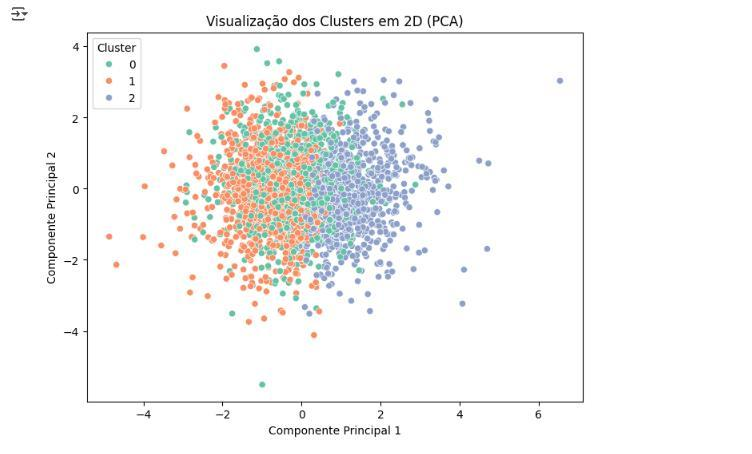
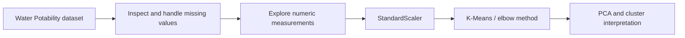

# Water Quality Clustering

**Exploratory analysis and unsupervised learning with Python.**

## Problem and approach

This academic case study explores whether physicochemical water measurements can be grouped into distinct profiles. The presentation uses a fictional environmental company as its context and describes an analysis of the Kaggle Water Potability dataset.

The work demonstrates data preparation, exploratory analysis, K-Means clustering and PCA visualization. Cluster labels are exploratory interpretations, not validated safety classifications.

## Available demonstration

[Read the original presentation (PDF)](presentation/4.0.pdf) — includes the original charts and conclusions in Portuguese.



*Original chart extracted from page 8 of the presentation. The clusters overlap in this projection.*

The presentation reports:

| Item | Reported in the presentation |
| --- | --- |
| Input dataset | 3,276 observations and 10 columns |
| Measurements | pH, hardness, solids, chloramines, sulfate, conductivity, organic carbon, trihalomethanes and turbidity |
| Model inputs | Numeric measurements, excluding the potability label |
| Scaling | StandardScaler |
| Clustering | K-Means, with three clusters selected using the elbow method |
| Visualization | PCA projection, distributions, boxplots and cluster summaries |

These details summarize the submitted study. A separate companion run is now available below; it does not claim exact historical replication.

## Workflow and technical decisions



Scaling makes measurements with different units comparable for distance-based clustering. PCA provides a two-dimensional view; visual separation alone does not establish model quality.

**Tools described in the study:** Python, pandas, NumPy, scikit-learn, Matplotlib and Seaborn.

## Reproduce the workflow

The original Colab notebook has been recovered from the link in the presentation. Its code uses **median imputation** and excludes `Potability` from the model inputs. Read the [notebook provenance notes](notebooks/README.md).

- [Recovered original source](notebooks/original_source.ipynb): code preserved, outputs and execution metadata cleared; retains the historical Colab path and chart labels.
- [Runnable companion notebook](notebooks/reproduce.ipynb): local paths, explicit parameters and neutral cluster labels; also available as `analysis.py`.
- [Recorded companion run](reports/2026-11-02/README.md): input checksum, package versions, cluster summaries and measured limitations.

Requirements: Python 3.11 is used in CI. Download `water_potability.csv` from the [source dataset](https://www.kaggle.com/datasets/adityakadiwal/water-potability) into `data/`; see [data provenance](data/README.md). The raw dataset is not redistributed here.

```bash
python3 -m venv .venv
source .venv/bin/activate
python -m pip install -r requirements-reproduce.txt
python analysis.py --csv data/water_potability.csv --output-dir outputs/companion
```

The command creates metrics, cluster assignments and means, an elbow curve and PCA plot. To use the notebook, install `requirements-dev.txt` and open `notebooks/reproduce.ipynb` with the same Python environment. Reusing an output directory replaces its generated report files.

## Verified companion results

The recorded run used all **3,276 observations**. The sampled silhouette score was **0.0766** (1,000 observations), suggesting weak separation for this configuration. The first two PCA components explained about **25.97%** of variance. These findings are documented rather than presented as strong clustering performance.

## Checks

```bash
python -m pip install -r requirements-dev.txt
python -m pytest -q
```

[CI](https://github.com/natgeo1997/water-quality-clustering/actions) uses synthetic test inputs to check median imputation, target exclusion, invalid inputs and repeatable outputs. The original notebook is an archive; CI tests the supported companion pipeline. The companion notebook was executed locally end to end on the source CSV.

## Limitations

- The PDF describes median imputation in one section and dropping rows in another. The recovered source confirms median imputation; the PDF is preserved as the original academic artifact.
- Exact historical results are not claimed: the old library environment and implicit K-Means initialization count are unknown. The companion explicitly uses n_init=10 and seed 42.
- The source notebook labels clusters as low/medium/high risk by index. Cluster IDs are arbitrary; those assignments are not validated safety or potability classes.
- Dataset rows are observations, not verified geographic regions. No operational or public-health decision system is demonstrated.
- Additional work could compare cluster stability, alternative k values and modeling choices. A low silhouette score is a reason to investigate, not to rename groups as meaningful risk levels.
