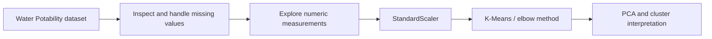

# Water Quality Clustering

**Exploratory analysis and unsupervised learning with Python.**

## Problem and approach

This academic case study explores whether physicochemical water measurements can be grouped into distinct profiles. The presentation uses a fictional environmental company as its context and describes an analysis of the Kaggle Water Potability dataset.

The work demonstrates data preparation, exploratory analysis, K-Means clustering and PCA visualization. Cluster labels are exploratory interpretations, not validated safety classifications.

## Available demonstration

[Read the original presentation (PDF)](presentation/4.0.pdf) — includes the original charts and conclusions in Portuguese.


*Original chart extracted from page 8 of the presentation. The clusters overlap in this projection.*

The presentation reports:

| Item | Reported in the presentation |
| --- | --- |
| Input dataset | 3,276 observations and 10 columns |
| Measurements | pH, hardness, solids, chloramines, sulfate, conductivity, organic carbon, trihalomethanes and turbidity |
| Model inputs | Numeric measurements, excluding the potability label |
| Scaling | StandardScaler |
| Clustering | K-Means, with three clusters selected using the elbow method |
| Visualization | PCA projection, distributions, boxplots and cluster summaries |

These details summarize the submitted study; the analysis has not been rerun from this repository.

## Workflow and technical decisions



Scaling makes measurements with different units comparable for distance-based clustering. PCA provides a two-dimensional view; visual separation alone does not establish model quality.

**Tools described in the study:** Python, pandas, NumPy, scikit-learn, Matplotlib and Seaborn.

## Repository contents and reproducibility

```text
README.md
presentation/
  4.0.pdf       Original academic presentation
  README.md    Guide to the presentation
docs/images/pca.jpg  Original PCA chart extracted from the PDF
```

The repository currently contains the presentation, not an executable notebook, dataset or dependency specification. Viewing the PDF requires no Python installation. The PDF references a Colab notebook, but its availability and reproducibility are not verified here.

## Limitations and next steps

- The presentation describes median imputation in one section and dropping missing rows in another. The exact final preprocessing cannot be established without the source notebook.
- Cluster interpretations and reported proportions have not been independently reproduced. No silhouette score, stability analysis or validated predictive performance is claimed here.
- The dataset observations should not be treated as verified geographic regions. The original presentation's region/risk terminology is part of its academic framing.
- Reproducible next steps are to publish the source notebook, document dataset provenance and preprocessing, set random seeds and evaluate cluster stability.
